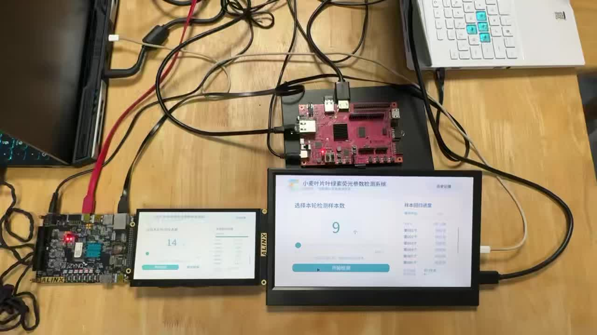
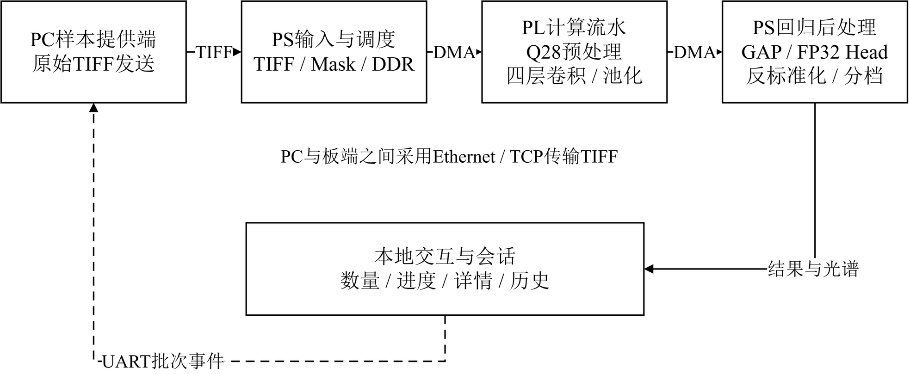

# Wheat Hyperspectral Edge Computing

[中文](README.md) | English



The system estimates PhiPSII from 204-band wheat leaf images, combining Ethernet input, FPGA acceleration, touch interaction and result history. AX7020 and PYNQ-Z2 share the CNN interface with board-specific hardware and displays.



## Key results

| Item | Result |
|---|---|
| AX7020 compute clock | 100 MHz |
| 400-image continuous run | All completed; mean board inference 1.321 s/image |
| Full AX7020 resources | 11,372 LUTs, 62 DSPs, 78 BRAM36 equivalents |
| Ten board predictions vs integer reference | Maximum absolute difference 2.54×10⁻⁸ |
| PYNQ-Z2 vs AX7020 | Ten RAW and ten INT16 runs; maximum prediction difference 0 |
| RTL transaction simulation | 15 cases passed |
| Conv1 representative transaction prefetch | 4.639 ms → 2.550 ms, 1.819× |

The 1.321 s includes board scheduling, DMA, PL, GAP and regression head. The 1.819× result is a same-core representative transaction simulation. See [performance and accuracy](docs/performance.md) for conditions and the historical CPU comparison.


This project deploys a four-layer 2DCNN on Zynq-7000 to estimate the wheat leaf physiological parameter PhiPSII from the public HyperLeaf2024 dataset. The input tensor has 204 spectral bands and a foreground mask, with a spatial size of 48 × 352. Convolution channels are 205 → 32 → 64 → 128 → 160.

The programmable logic (PL) executes four convolution layers, ReLU and pooling using INT16 inputs and weights, 48-bit accumulation and F48 requantization. The processing system (PS) handles TIFF parsing, data management, DMA scheduling, global average pooling (GAP), the FP32 regression head and result display. The accelerator interface is v1.4 (`VERSION=0x00010004`), processing 158 tiles and 316 commands per image.

## Repository contents

| Path | Contents |
|---|---|
| [model/](model/) | Model code, checkpoints and normalization parameters |
| [golden/](golden/) | INT16 weights, scales, input example and numerical specification |
| [data_contract/](data_contract/) | Fixed data split |
| [fpga/](fpga/) | RTL, integer reference, Linux drivers, board bit/HWH files and implementation reports |
| [ip/](ip/) | CNN and display IP |
| [board/](board/) | Vivado sources, service templates and recorded PYNQ-Z2 results |
| [ui/](ui/) | Interface, session services and PC sender |
| [sim/](sim/) | RTL transaction simulation vectors |
| [scripts/](scripts/) | Build, simulation, replay and comparison scripts |
| [images/](images/) | Ten TIFF samples |
| [data/](data/) | Reference predictions, per-layer arrays for sample 00001 and sample lists |
| [skill/](skill/) | Reproduction skill for the four-layer CNN on both boards |
| [docs/](docs/) | Environment, source attribution, build, interface and test documentation |
| [report/design_report.pdf](report/design_report.pdf) | Design report, including optimization and AI-assisted development |
| [build.tcl](build.tcl) | AX7020 build entry point |
| [build_pynq_z2.tcl](build_pynq_z2.tcl) | PYNQ-Z2 build entry point |
| [start_pc_sender.cmd](start_pc_sender.cmd) | Windows UART event listener and Ethernet sender |

Generated Vivado and simulation files go to `build/`; local comparison and inference outputs go to `results/`. Included references are in `data/`, and recorded PYNQ-Z2 results are in `board/results/`.

## Boards and PYNQ versions

Read the [reproduction skill](skill/hyperleaf-zynq-reproduce/SKILL.md) and select the entry point matching your board and PYNQ version. The linked detailed instructions are in Chinese.

| Board | Environment and instructions | Recorded testing |
|---|---|---|
| AX7020, XC7Z020-2, 1 GB DDR3 | PYNQ 3.1.2; [run guide](docs/run.md) | Ten TIFF samples by direct read and Ethernet; 400-image continuous run |
| PYNQ-Z2, XC7Z020-1, 512 MB DDR3 | PYNQ 2.1; [run guide](skill/hyperleaf-zynq-reproduce/references/pynq21.md) | Ten RAW and ten INT16 runs; predictions matched AX7020 |
| PYNQ-Z2, XC7Z020-1, 512 MB DDR3 | PYNQ 3.1.1; [run guide](docs/run_pynq311.md) | Local code and API checks; recorded board results use PYNQ 2.1 |

The boards share the CNN interface but use their own PS/DDR configuration, constraints and bit/HWH files. The AX7020 display driver matches Linux kernel `6.6.10-xilinx-v2024.1-g9299000c9490`. Use the PYNQ 2.1 adapter for that version; the PYNQ-Z2 3.1.1 entry point targets 3.1.1.

## Local numerical comparison

Run the commands from the repository root:

```sh
python -m pip install numpy tifffile pillow pyserial
python scripts/verify_outputs.py
```

This recomputes sample 00001 and compares it with saved board outputs. The expected mismatch count is zero for all four layers and GAP, with a maximum difference of 0 LSB; the final prediction differs from the reference by at most 1e-7. Outputs are written to `results/integer_board_00001/`.

To replay all ten included TIFFs through the CPU integer reference:

```sh
python scripts/replay_local.py
```

The expected quantized inputs match the original FP32 preprocessing steps and the predictions match the included integer references. Outputs are written to `results/local_tiff_10/`. These local comparisons use NumPy and do not require PyTorch. See [environment and sources](docs/environment.md) for model training and export dependencies.

## RTL simulation and hardware build

Use Vivado 2024.1, place the project in a short ASCII path, and run in a terminal with Vivado simulation tools available:

```sh
python scripts/simulate.py
```

The expected output is `TEST_PASS overlay`. The 15 transaction cases compare 16,312 output words, 72,560 pre-pooling values and 21,012 preprocessing words. Simulation output is placed in `build/simulation/`.

To restore the AX7020 block design and then build bit/HWH files:

```sh
vivado -mode batch -source build.tcl -tclargs bd
vivado -mode batch -source build.tcl
```

See the [AX7020 build guide](docs/build.md) for output locations and the [PYNQ-Z2 build guide](docs/build_pynq_z2.md) for `build_pynq_z2.tcl`. Build scripts generate files; the operator selects and confirms the appropriate bit/HWH pair before programming a board.

## Board replay and results

Follow the [AX7020 run guide](docs/run.md) or the PYNQ-Z2 entry matching the installed PYNQ version. Core inference and comparison can run without a display; display and touch or mouse configuration are board-specific.

The fixed sample IDs are 00001, 00002, 00014, 00022, 00034, 00047, 00048, 00059, 00064 and 00070. Run 00001 first, then all ten. Each image is expected to complete 316 commands with status 0. The recorded maximum absolute difference between AX7020 predictions and the integer reference was 2.54e-8; PYNQ-Z2 RAW and INT16 predictions matched the AX7020 measurements.

The Ethernet demo defaults to PC address 192.168.137.1 and AX7020 address 192.168.137.2. On Windows, run `start_pc_sender.cmd` and select the connected serial port. Ten TIFFs are included. The 400-image selection list and predictions are included; the corresponding TIFFs must be supplied separately to repeat that run.

Additional documentation: [results](docs/results.md), [PYNQ-Z2 interfaces](docs/pynq_z2_interfaces.md), [numerical and command contracts](skill/hyperleaf-zynq-reproduce/references/contracts.md), and [environment and third-party sources](docs/environment.md).

## License

RTL, software and scripts originally created by the developers, for which they have licensing rights, are released under the GNU General Public License v3.0; see [LICENSE](LICENSE).

Third-party source code, IP, drivers, fonts, data and other materials retain their original copyright and license terms; see [environment and sources](docs/environment.md). HyperLeaf2024 data and samples are subject to the data provider's terms. Model weights and third-party materials are used and distributed under their applicable authorizations.
