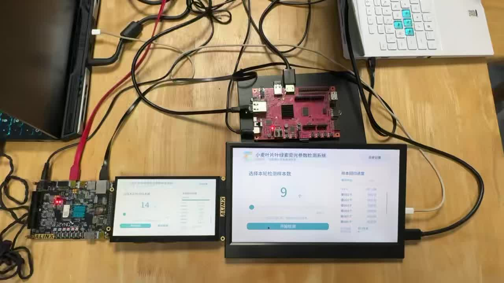
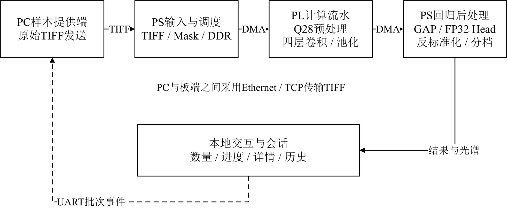

# 面向小麦高光谱的端侧部署

中文 | [English](README.en.md)



系统将小麦叶片的204波段高光谱影像转换为PhiPSII预测，支持网口输入、FPGA加速、触摸操作和历史回看。AX7020与PYNQ-Z2使用同一卷积接口，分别适配各自硬件与显示设备。



## 主要结果

| 项目 | 结果 |
|---|---|
| AX7020计算时钟 | 100 MHz |
| 400张连续检测 | 全部完成，板端推理平均1.321秒/张 |
| 完整AX7020工程资源 | 11,372 LUT、62 DSP、78块BRAM36等效 |
| 十张TIFF板端预测对整数参考 | 最大绝对差 2.54×10⁻⁸ |
| PYNQ-Z2与AX7020 | RAW及INT16各十次，预测最大差为0 |
| RTL事务仿真 | 15组通过 |
| Conv1代表事务预取优化 | 4.639 ms → 2.550 ms，1.819倍 |

上述1.321秒包含板端调度、DMA、PL、GAP与回归头；1.819倍来自同核代表事务仿真。测试条件和历史CPU对照见[性能与精度说明](docs/performance.md)。


本工程使用公开数据集HyperLeaf2024的小麦叶片高光谱影像，部署四层2DCNN，预测叶片生理参数PhiPSII。模型通道为205→32→64→128→160，输入为204个光谱波段及一个前景Mask通道，空间尺寸为48×352。

PL使用INT16输入与权重、48位累加和F48重量化，执行四层卷积、ReLU与池化；PS负责TIFF解析、数据管理、DMA调度、GAP、FP32回归头和结果展示。计算接口版本为v1.4，VERSION为0x00010004；每张样本处理158个分块、执行316条命令。

## 工程内容

| 目录或文件 | 用途 |
|---|---|
| [model/](model/) | 模型源码、checkpoint和标准化参数 |
| [golden/](golden/) | INT16权重、尺度、输入样例及数值规范 |
| [data_contract/](data_contract/) | 固定数据划分 |
| [fpga/](fpga/) | RTL、整数参考、Linux驱动、两板bit/HWH及实现报告 |
| [ip/](ip/) | CNN与显示IP |
| [board/](board/) | 两板Vivado工程源文件、服务模板及PYNQ-Z2实测结果 |
| [ui/](ui/) | 显示界面、会话服务和PC发送程序 |
| [sim/](sim/) | RTL事务仿真向量 |
| [scripts/](scripts/) | 构建辅助、运行、仿真及结果比较脚本 |
| [images/](images/) | 十张原始TIFF复测样本 |
| [data/](data/) | 参考预测、00001逐层数组及样本清单 |
| [skill/](skill/) | AX7020与PYNQ-Z2的四层CNN复现Skill |
| [docs/](docs/) | 环境、来源、构建、接口、运行及测试结果说明 |
| [report/design_report.pdf](report/design_report.pdf) | 设计报告，含优化过程、大模型协作和Skill提炼 |
| [build.tcl](build.tcl) | AX7020硬件构建入口 |
| [build_pynq_z2.tcl](build_pynq_z2.tcl) | PYNQ-Z2硬件构建入口 |
| [start_pc_sender.cmd](start_pc_sender.cmd) | Windows端UART控制监听与网口送样入口 |

运行后生成的Vivado工程与仿真输出位于`build/`，本地数值比较和推理输出位于`results/`。随包参考数据保存在`data/`，PYNQ-Z2已有实测输出保存在`board/results/`。

## 选择板卡与系统版本

先阅读[复现Skill](skill/hyperleaf-zynq-reproduce/SKILL.md)，再按实际板卡和PYNQ版本选择入口。

| 板卡 | 系统与运行入口 | 已有测试情况 |
|---|---|---|
| AX7020，XC7Z020-2，1 GB DDR3 | PYNQ 3.1.2；[运行说明](docs/run.md) | 十张TIFF直读与网口输入、400张连续检测 |
| PYNQ-Z2，XC7Z020-1，512 MB DDR3 | PYNQ 2.1；[运行说明](skill/hyperleaf-zynq-reproduce/references/pynq21.md) | RAW和INT16各十张，最终预测与AX7020一致 |
| PYNQ-Z2，XC7Z020-1，512 MB DDR3 | PYNQ 3.1.1；[运行说明](docs/run_pynq311.md) | 已完成本地代码和API检查；实板记录来自PYNQ 2.1入口 |

两板共用CNN计算接口，分别使用各自的PS/DDR配置、约束和bit/HWH。AX7020显示驱动对应Linux内核`6.6.10-xilinx-v2024.1-g9299000c9490`。PYNQ-Z2的3.1.1入口按该版本实现，使用PYNQ 2.1时选择专用适配程序。

## 在PC上进行数值比较

以下命令均在本工程根目录执行。先安装Python依赖：

```sh
python -m pip install numpy tifffile pillow pyserial
```

重新计算00001的整数卷积、池化、GAP与回归头，并比较保存的板端输出：

```sh
python scripts/verify_outputs.py
```

预期四层输出及GAP的不一致元素数均为0，最大差为0 LSB，最终预测与参考差不超过1e-7。结果写入`results/integer_board_00001/`。

从随包十张原始TIFF运行CPU整数参考：

```sh
python scripts/replay_local.py
```

预期十张输入量化结果与原FP32处理步骤一致，最终预测与随包整数参考一致。结果写入`results/local_tiff_10/`。这两个本地入口使用NumPy执行整数计算，无需安装PyTorch；重新训练或导出模型所需环境见[环境与来源](docs/environment.md)。

## RTL仿真与硬件构建

工具使用Vivado 2024.1。将工程放在短英文路径，并在能够调用Vivado仿真工具的终端执行：

```sh
python scripts/simulate.py
```

预期输出`TEST_PASS overlay`，完成15组事务比较，包括16,312个输出字、72,560个池化前值和21,012个预处理字。仿真产物位于`build/simulation/`。

AX7020先恢复系统设计，再综合、布局布线并生成bit/HWH：

```sh
vivado -mode batch -source build.tcl -tclargs bd
vivado -mode batch -source build.tcl
```

详细步骤与生成位置见[AX7020构建说明](docs/build.md)。PYNQ-Z2使用[专用构建说明](docs/build_pynq_z2.md)及`build_pynq_z2.tcl`。构建脚本生成文件，不下载位流；上板时由操作者确认目标板与配套bit/HWH。

## 上板运行与结果比较

AX7020按[运行说明](docs/run.md)安装服务并运行十样本回放；PYNQ-Z2按上表中的系统版本入口执行。无屏条件下可完成核心推理与结果比较，显示和触摸或鼠标操作按各自外设配置。

十张固定样本为00001、00002、00014、00022、00034、00047、00048、00059、00064、00070。先运行00001，再运行十张；每张应完成316条命令，状态为0。AX7020十样本预测与整数参考的实测最大绝对差为2.54e-8，PYNQ-Z2的RAW及INT16十样本预测与AX7020实测最大差为0。

网口演示默认PC地址为192.168.137.1、AX7020地址为192.168.137.2。Windows端运行`start_pc_sender.cmd`，按实际连接选择串口。十张TIFF已随工程提供；400张连续检测的选择清单和预测结果随包提供，运行400张检测时另行准备对应原始TIFF。

更多内容：

- [测试结果](docs/results.md)
- [PYNQ-Z2接口说明](docs/pynq_z2_interfaces.md)
- [数值与命令约定](skill/hyperleaf-zynq-reproduce/references/contracts.md)
- [环境、依赖与第三方来源](docs/environment.md)

## 开源许可

本工程中由开发者原创且有权授权的RTL、软件代码及脚本采用 GNU General Public License v3.0 发布，协议全文见 [LICENSE](LICENSE)。

本工程包含第三方提供的源码、IP、驱动、字体、数据和其他材料。这些内容保留原有版权及许可声明，来源见[环境与来源说明](docs/environment.md)。HyperLeaf2024数据及样本遵守数据提供方的使用条款；模型权重及第三方材料的使用和分发按照各自适用的授权执行。
